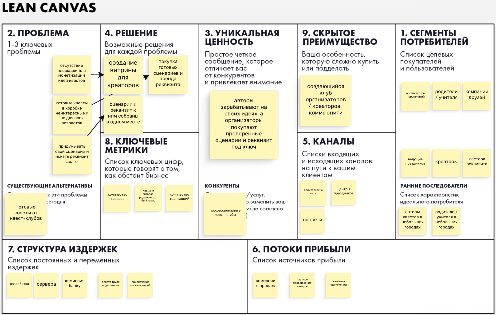

# Задание 1

## Elevator pitch

Организатору квеста -- родителю, учителю или компании друзей -- приходится либо покупать дорогой готовый «квест в коробке», либо долго придумывать сценарий и искать реквизит самому. Мы делаем C2C-маркетплейс, где авторы продают готовые сценарии квестов и сдают в аренду/продают реквизит под них, а организаторы находят и покупают всё в одном месте. В отличие от других сервисов продажи, здесь сценарий и реквизит продаются вместе, с отзывами после реального проведения. В результате авторы монетизируют свои идеи, а организаторы получают проверенный квест под свой возраст, место и бюджет за минуты вместо дней.

## Lean Canvas

