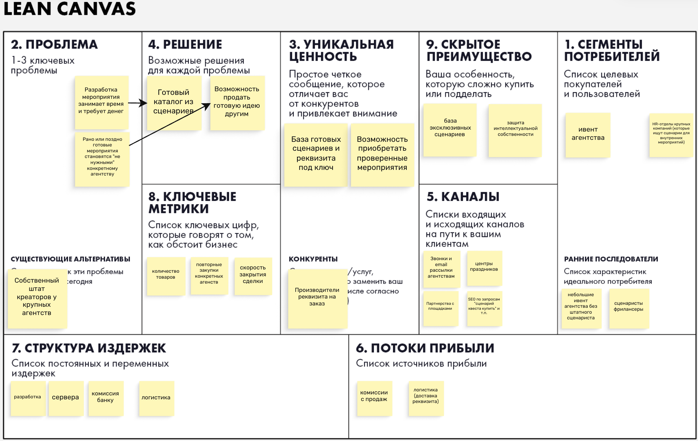

Квест-маркетплейс сценариев и реквизита (C2C)
# Задание 1

## Elevator pitch

Организатору квеста -- родителю, учителю или компании друзей -- приходится либо покупать дорогой готовый «квест в коробке», либо долго придумывать сценарий и искать реквизит самому. Мы делаем C2C-маркетплейс, где авторы продают готовые сценарии квестов и сдают в аренду/продают реквизит под них, а организаторы находят и покупают всё в одном месте. В отличие от других сервисов продажи, здесь сценарий и реквизит продаются вместе, с отзывами после реального проведения. В результате авторы монетизируют свои идеи, а организаторы получают проверенный квест под свой возраст, место и бюджет за минуты вместо дней.

## Lean Canvas

# Задание 2
## HADI-гипотеза
HADI-гипотеза

H:

Мы верим, что родители / организаторы детских праздников готовы покупать готовые сценарии квестов и реквизит к ним напрямую у частных авторов на нашей платформе, если цена будет ниже, чем у ивент-агентств, и если они увидят реальные отзывы о том, что этот квест уже успешно проводили другие.

Ожидаемое изменение поведения: пользователь переходит на сайт, находит нужный сценарий и совершает реальную оплату, а не просто уходит скачивать бесплатные шаблоны.

A:

Подбираем первых авторов с 3–5 реальными сценариями. Запускаем небольшой таргет в соцсетях (1 город). Человек заходит, смотрит карточки, нажимает «Купить» и попадает на форму оплаты. После оплаты файл сценария приходит на почту.

D:

Ключевая метрика: Конверсия из уникального посетителя в успешную оплату.
Дополнительная метрика: Стоимость привлечения одного покупателя (CAC).

I:

Успех: Если конверсия в покупку составляет хотя бы 3-5%, признаем гипотезу верной. Люди готовы платить, модель работает, можно масштабировать и писать полноценную платформу.

Провал: Если конверсия меньше 0,5% или люди заходят, добавляют в корзину, но бросают на этапе оплаты (высокий процент отказов), значит, доверия к частным авторам нет или цена кажется завышенной.

## Сходимость

CAC:

Клик в рекламе: 30 Р.

Рекламный бюджет: 30 000 Р.

Пришло трафика: 30 000 / 30 = 1 000 посетителей.

Конверсия в регистрацию: 10% 

1 000 * 10% = 100.

Конверсия в оплату: 10%.

Получаем покупателей: 100 * 10% = 10 покупателей.

CAC: 30 000 Р / 10 покупателей = 3 000 Р за одного покупателя.

LTV:

Средний чек: 1 000 Р.

Наша комиссия: 20%.

Выручка с одной покупки: 200 Р.

Частота покупок: организатор праздника организовывает их в среднем 5 раз в год

Срок жизни клиента: 3 года

Итого покупок за жизнь: 5 покупкок * 3 года = 15 покупкок.

13% налог: 174 Р с покупки

LTV: 15 * 174 = 2 610

LTV меньше CAC (не сходится).

## Pivot

B2B: продажа готовых квестов от агенств другим агенствам.

CAC

Рекламный/Маркетинговый бюджет: 50 000 Р (платная база контактов агентств, зарплата/бонус менеджера по продажам за звонки)

Пришло трафика: Менеджер связывается с 1 000 представителей ивент-агентств и организаторов.

Проявили интерес: 5%.

Получаем 50 заинтересованных агентств.

Конверсия в первую сделку: 10% (Агентства заказывают пробный квест для конкретного клиента).

Получаем 5 платящих компаний.

CAC: 50 000 Р / 5 компаний = 10 000 Р за одного клиента.

LTV

Средний чек для агентства: 15 000 Р

Наша комиссия: 10%.

Выручка с одной сделки: 1 500 Р.

Частота покупок: 10 раз в год.

Срок жизни: 2 года

Итого сделок: 10 закупок * 2 года = 20 сделок.

Переменные издержки: 13% (эквайринг + налоги) от 1 500 Р = 195 Р.

Чистая прибыль с одной сделки: 1 500 - 195 = 1 305 Р.

LTV: 1 305 Р * 20 сделок = 26 100 Р.

26 100 / 10 000 = 2.61

## Lean Canvas

